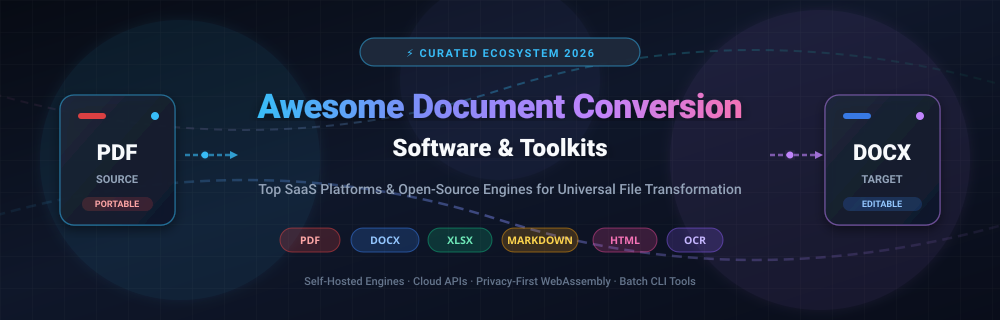

<<<<<<< HEAD
# Awesome-Document-Conversion-Software

=======

  

# Awesome-Document-Conversion-Software

  
  
  

## Top Digital Negative (DNG) Conversion

**Curated List of SaaS Products & Open-Source GitHub Projects**

*Focused on RAW to DNG Conversion, Camera Raw Processing, Universal RAW Formats & Desktop RAW Tools*

**Last updated: October 2026**

This repository tracks notable **commercial applications** and **open-source projects** for **Digital Negative (DNG) Conversion** and RAW file processing. These tools convert proprietary camera RAW formats into the open Adobe DNG standard or provide advanced RAW decoding and development capabilities.

**Examples** include Adobe DNG Converter, RawTherapee, darktable, DxO PureRAW, Capture One, FastRawViewer, Iridient Developer, dcraw, LibRaw, and ON1 NoNoise AI (the category leaders).

**Open-source emphasis**: DNG and RAW processing benefits from excellent open-source foundations. **LibRaw**, **dcraw**, **darktable**, **RawTherapee**, and related projects provide robust, fully free tools for converting, decoding, and processing camera RAW files. This section is heavily expanded.

Contributions welcome! Open a PR to add/update entries. Keep descriptions factual and link to official sites.

## Table of Contents
- [SaaS/Hosted Platforms](#saas-hosted-platforms)
- [Open-Source GitHub Projects](#open-source-github-projects)
- [How to Contribute](#how-to-contribute)
- [Disclaimer](#disclaimer)

## SaaS/Hosted Platforms

| Product | Pricing | Free Tier / Limits | Description |
| :--- | :--- | :--- | :--- |
| **[Adobe DNG Converter](https://helpx.adobe.com/camera-raw/using/adobe-dng-converter.html)** | Free | 100% Free standalone desktop utility | Official free utility from Adobe that converts proprietary camera RAW files into the open Digital Negative (DNG) format for archival. |
| **[DxO PureRAW](https://www.dxo.com/dxo-pureraw/)** | ~$129 one-time purchase | 30-day fully functional free trial | Specialized RAW processing tool focused on superior denoising (DeepPRIME), demosaicing, and optical corrections before exporting to DNG. |
| **[Capture One](https://www.captureone.com/)** | ~$24/mo or $299 perpetual license | 30-day free trial | Professional RAW editor that supports high-quality conversion and export to DNG alongside its advanced color grading and tethered workflow tools. |
| **[FastRawViewer](https://www.fastrawviewer.com/)** | ~$24.99 one-time license | 30-day free trial | Fast RAW viewer and analysis tool that can work with DNG and proprietary RAW files, popular for culling and technical inspection. |
| **[Iridient Developer](https://www.iridientdigital.com/)** | ~$39.99 one-time license | Free evaluation mode (watermarked output) | High-quality RAW developer known for exceptional demosaicing and detail rendering, with strong DNG support. |
| **[ON1 NoNoise AI / Photo RAW](https://www.on1.com/)** | ~$69.99 one-time or $7.99/mo | 14-day free trial | AI-powered noise reduction and RAW processing tools that can output cleaned files in DNG and other formats. |
| **[Adobe Camera Raw / Lightroom](https://www.adobe.com/products/photoshop-lightroom-classic.html)** | From $9.99/mo (Photography plan) | 7-day free trial | Industry-standard RAW processing engine that natively supports DNG and integrates seamlessly into photography pipelines. |
| **[Affinity Photo](https://affinity.serif.com/photo/)** | ~$69.99 one-time purchase (no subscription) | 30-day free trial | Professional photo editor with solid RAW development capabilities and full support for DNG files. |
| **[Exposure X](https://exposure.software/)** | ~$129 one-time purchase | 30-day free trial | Creative RAW editor that works with DNG and proprietary formats, focused on non-destructive editing and film-inspired looks. |
| **[PhotoLab (DxO)](https://www.dxo.com/dxo-photolab/)** | ~$229 one-time purchase | 30-day free trial | Advanced RAW converter with DeepPRIME XD technology that processes and exports pristine DNG files. |

## Open-Source GitHub Projects

- **[LibRaw](https://github.com/LibRaw/LibRaw)**  
  Widely used open-source library for reading and processing RAW files from a broad range of digital cameras. Foundation for many RAW converters and DNG-related tools.

- **[dcraw](https://github.com)** (original by Dave Coffin) / modern forks  
  Classic open-source RAW decoder that pioneered support for many camera formats. Still influential and used as a reference or backend in various tools.

- **[darktable](https://github.com/darktable-org/darktable)**  
  Powerful open-source photography workflow application with excellent RAW support. Can import proprietary RAW files and work with or export DNG in professional pipelines.

- **[RawTherapee](https://github.com/Beep558/RawTherapee)**  
  Advanced open-source RAW image processing program with high-quality demosaicing, detailed controls, and support for DNG and many proprietary formats.

- **[ART (Another RawTherapee)](https://github.com/artpixls/ART)**  
  Actively maintained fork of RawTherapee focused on usability improvements and continued development of open-source RAW processing.

- **[ExifTool](https://github.com/exiftool/exiftool)**  
  Legendary open-source metadata tool that can read, write, and manipulate DNG and RAW metadata, essential for batch conversion workflows.

- **[rawspeed](https://github.com/darktable-org/rawspeed)**  
  Fast open-source RAW decoding library used by darktable and other projects for high-performance camera support.

- **[UFRaw](https://github.com)** (legacy) / modern successors  
  Earlier open-source RAW developer that integrated with GIMP; its ideas live on in current tools.

- **[RawPy](https://github.com/letmaik/rawpy)**  
  Python wrapper around LibRaw, making it easy to read and process RAW/DNG files in Python scripts and pipelines.

- **[DNG SDK related open tools](https://github.com)**  
  Community tools and scripts built around Adobe’s DNG specification for validation, conversion, and archival workflows.

### Additional Strong Open-Source Options
- Core decoding libraries: **LibRaw**, **rawspeed**, **dcraw** lineage.
- Full RAW editors with DNG support: **darktable**, **RawTherapee**, **ART**.
- Metadata & batch processing: **ExifTool**.
- Scripting / automation: **RawPy** and LibRaw bindings.
- Accepting that commercial tools (Adobe DNG Converter, DxO PureRAW, Capture One, Iridient Developer) still lead in ease of use, optical corrections, AI denoising, and polished one-click conversion for many photographers.

**Frameworks for building custom systems**:  
Use **LibRaw** or **rawspeed** for decoding → process with **darktable** or **RawTherapee/ART** → handle metadata with **ExifTool** → automate via **RawPy** or shell scripts. Ideal for photographers, archivists, and developers who want open, long-term accessible RAW/DNG pipelines without proprietary lock-in.

## How to Contribute
1. Fork the repo.
2. Add/edit entries in `README.md` (follow existing format).
3. Include: name, link, 1–2 sentence description, and whether it's SaaS or open-source.
4. Submit PR with a short explanation.

Star the repo if you find it useful!

## Disclaimer
- This is a **community-curated** list — not exhaustive and not an endorsement.
- Camera RAW support varies by tool and camera model. Always verify compatibility with your specific camera files. DNG is an open standard, but conversion quality and feature support differ between applications. This list is not professional archival or photography advice.

---
**Made for photographers, digital archivists, and open-source imaging advocates.**

Let's keep RAW processing and DNG conversion open, reliable, and future-proof.
>>>>>>> 72a288fb4613ad2992ba45edfb2429defc6eed28
# Top Document Conversion Software Ecosystem

**Curated List of SaaS Products & Open-Source GitHub Projects**  
*Focused on Format Transformation, PDF Editing & Self-Hosted Document Processing*  
**Last updated: October 2026**

This repository tracks notable **SaaS platforms** and **open-source projects** for **Document Conversion Software**. These tools enable users to convert documents between formats (PDF, DOCX, ODT, HTML, Markdown, and more), edit PDFs, and process document workflows without relying on proprietary desktop suites or per-file cloud uploads.

**Examples** include Adobe Acrobat Export PDF, CloudConvert, Zamzar, Smallpdf, iLovePDF, Nitro Cloud, Wondershare PDF Converter, Soda PDF, PDF Candy, and FreePDFConvert (the category leaders).

**Open-source emphasis**: This section is heavily expanded with active projects for self-hosted document conversion, browser-based PDF toolkits, and command-line batch processing — ideal for privacy-conscious teams, developers, and enterprises replacing paid SaaS with sovereign infrastructure.

Contributions welcome! Open a PR to add/update entries. Keep descriptions factual and link to official sites.

## Table of Contents
- [SaaS/Hosted Platforms](#saas-products)
- [Open-Source GitHub Projects](#open-source-github-projects)
- [How to Contribute](#how-to-contribute)
- [Disclaimer](#disclaimer)

## SaaS/Hosted Platforms

- **[Adobe Acrobat Export PDF](https://www.adobe.com/acrobat/online/pdf-to-word.html)**  
  Adobe's cloud service for exporting PDFs to editable Word, Excel, and PowerPoint formats with high fidelity to original layouts.

- **[CloudConvert](https://cloudconvert.com/)**  
  File conversion API and web interface supporting 200+ formats, with job orchestration, webhooks, and batch processing for documents, images, and media.

- **[Zamzar](https://www.zamzar.com/)**  
  Online file conversion service covering over 1,100 format pairs, including document, image, audio, and video conversions.

- **[Smallpdf](https://smallpdf.com/)**  
  Suite of PDF tools including conversion (PDF to/from Word, Excel, PPT), compression, merging, and e-signing, with a clean web interface.

- **[iLovePDF](https://www.ilovepdf.com/)**  
  Popular PDF toolkit for conversion, merge, split, compress, OCR, and watermarking, available via web and API.

- **[Nitro Cloud](https://www.gonitro.com/)**  
  Cloud-based PDF conversion and editing service integrated with Nitro's desktop productivity suite.

- **[Wondershare PDF Converter](https://pdf.wondershare.com/pdf-converter/)**  
  Desktop and cloud conversion tool for transforming PDFs into Office formats and images with OCR support.

- **[Soda PDF](https://www.sodapdf.com/)**  
  PDF editing and conversion platform with online and desktop options, supporting creation, conversion, and e-signing.

- **[PDF Candy](https://pdfcandy.com/)**  
  Free online PDF toolkit with conversion, editing, and utility tools, plus a desktop version for offline use.

- **[FreePDFConvert](https://www.freepdfconvert.com/)**  
  Simple web-based PDF conversion service for PDF to Word, Excel, and other formats.

## Open-Source GitHub Projects

- **[Stirling-PDF](https://github.com/Stirling-Tools/Stirling-PDF)**  
  Self-hosted, web-based PDF manipulation powerhouse with 50+ tools including merge, split, OCR, sign, redact, compress, and **Office format conversion** (DOCX, XLSX, PPTX, ODT) via embedded LibreOffice; Docker-deployable with user accounts and REST API .

- **[BentoPDF](https://github.com/alam00000/bentopdf)**  
  Privacy-first, browser-based PDF toolkit with 130+ tools; performs **PDF↔Office conversion** entirely client-side using WebAssembly (LibreOffice WASM, PyMuPDF, Ghostscript), with no file uploads to any server; self-hostable via Docker or static hosting .

- **[Pandoc](https://github.com/jgm/pandoc)**  
  The universal document converter, supporting conversion between dozens of markup and document formats including Markdown, DOCX, ODT, HTML, LaTeX, EPUB, and PDF (via external engines); the standard for programmatic, scriptable format transformation .

- **[LibreOffice](https://github.com/LibreOffice/core)**  
  Full open-source office suite with powerful headless conversion via `soffice --headless --convert-to`; converts DOCX, XLSX, PPTX, ODT, PDF, HTML, and more from the command line, making it the backbone of most self-hosted conversion pipelines .

- **[ConvertAgent](https://github.com/vid-factory/convertagent)**  
  Self-hosted file conversion toolkit designed for AI agents and developers; exposes CLI, REST API, and MCP server interfaces backed by FFmpeg, LibreOffice, ImageMagick, and Pandoc; supports 20 conversion pairs including PDF→DOCX, DOCX→PDF, HTML→PDF, and Markdown→DOCX .

- **[anyconvert](https://github.com/word-sys/anyconvert)**  
  Pure-Python PDF conversion engine that outputs DOCX, PPTX, ODT, ODP, and TXT using only the standard library; offers **Canvas Mode** for pixel-accurate layout preservation and **Flow Mode** for semantic reflowable reconstruction; supports encrypted PDFs and standards-compliant OPC/ODF packaging .

- **[Duckling](https://github.com/excelano/duckling)**  
  Offline GUI for document conversion powered by `docling.rs` (Rust port of IBM Docling); converts Word, PowerPoint, Excel, PDF, HTML, EPUB, RTF, and OpenDocument files to Markdown, JSON, LaTeX, DOCX, ODT, and more; includes built-in OCR for scanned documents; MIT-licensed .

- **[file-converter-tool](https://github.com/ab0jwad/file-converter)**  
  Python-based multi-format converter with CLI and GUI; supports document (PDF→DOCX, TXT→DOCX, Markdown→HTML), data (CSV↔JSON, XML, XLSX), and image format conversions; MIT-licensed and pip-installable .

- **[pdf2wordx](https://pypi.org/project/pdf2wordx/)**  
  Free desktop application (Python/Tkinter) for converting PDF files to editable DOCX documents in two clicks; no cloud uploads, no subscriptions; uses the `pdf2docx` library as its conversion engine .

- **[DocWen](https://github.com/ZHYX91/docwen)**  
  Local-first GUI and CLI for document conversion and proofreading; supports Word↔Markdown, Excel/CSV↔Markdown workflows with template systems, punctuation checking, and sensitive word detection .

### Additional Strong Open-Source Options

- **Ghostscript** — The foundational PostScript/PDF interpreter and rasterizer; essential for PDF/A conversion, font outlining, and PDF manipulation in larger pipelines.
- **qpdf** — Command-line PDF transformation tool for linearization, encryption, and structural repair; bundled inside Stirling-PDF and BentoPDF.
- **PyMuPDF** — High-performance Python library for PDF manipulation, text extraction, and rendering; powers conversion features in several browser-based toolkits.
- **pdf-lib** — JavaScript library for creating and modifying PDFs in browser and Node.js; used by BentoPDF for core PDF operations.
- **Calibre** — E-book management and conversion suite with powerful format transformation for EPUB, MOBI, AZW3, PDF, and more .

**Frameworks for building custom systems**: Combine **LibreOffice** headless for Office format conversion, **Pandoc** for markup transformation, **Stirling-PDF** or **BentoPDF** as the user-facing web interface, and **Ghostscript** or **qpdf** for PDF-specific processing in a fully self-hosted document conversion pipeline.

## How to Contribute

1. Fork the repo.
2. Add/edit entries in `README.md` (follow existing format).
3. Include: name, link, 1–2 sentence description, and whether it's SaaS or open-source.
4. Submit PR with a short explanation.

Star the repo if you find it useful!

## Disclaimer

- This is a **community-curated** list — not exhaustive and not an endorsement.
- Document conversion tools must comply with applicable regulations and respect the licensing terms of any bundled or referenced third-party engines.
- Self-hosted open-source solutions require proper security hardening, resource planning (especially for LibreOffice-based conversions which can be memory-intensive), and output quality validation for complex layouts.
- Verify license terms for commercial use; some projects use AGPL-3.0 or similar licenses that may require releasing derivative code if distributed.

---

**Made for developers, IT administrators, privacy-conscious teams, and document workflow engineers.**  
Let's make document conversion more open, private, and accessible.
